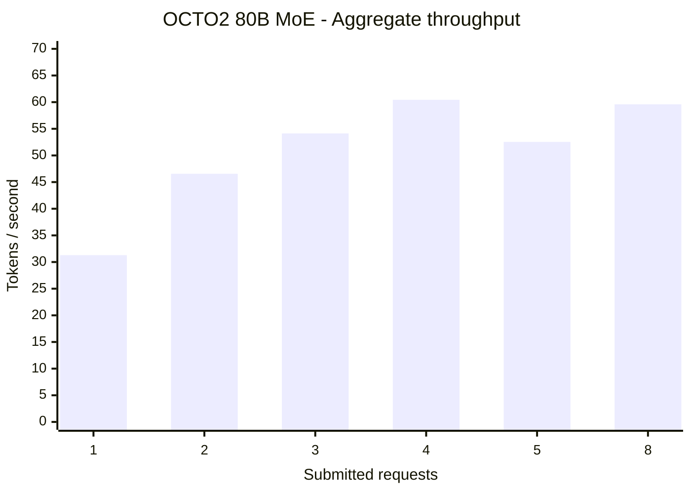
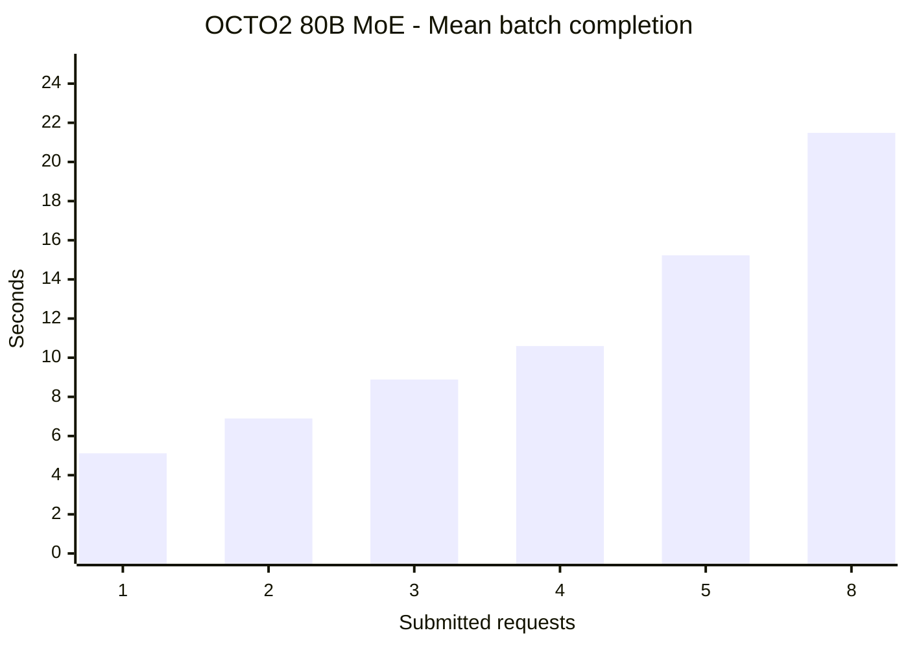
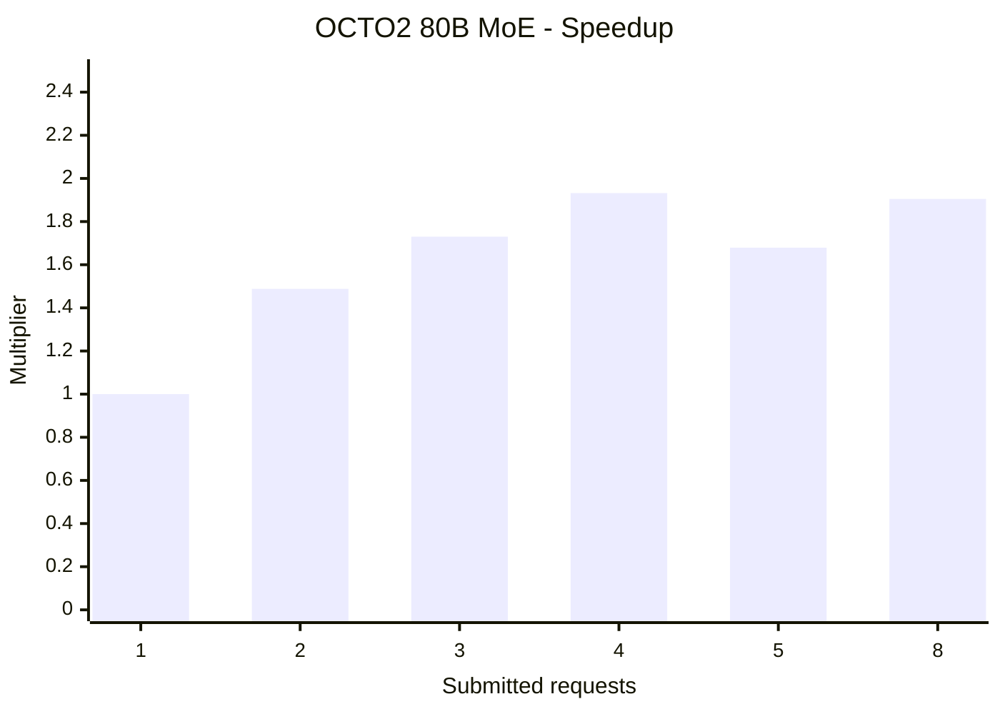

# OCTO2 Qwen3-Next 80B MoE concurrency benchmark — 2026-10-08

**Project:** Riverview / OctoMiner campaign  
**Date/time:** 2026-10-08 20:08–20:10 EDT (start recorded; finish time not separately recorded).  
**Evidence:** User-provided PowerShell console precheck and full benchmark output. No direct independent execution claimed.  
**Changes to OCTO2:** None; read-only precheck followed by inference requests against running service.

## Result

**46/46 inference requests succeeded; 7,360 generated tokens across 12 batches.** Best mean aggregate end-to-end throughput: **60.438 tok/s at 4 concurrent requests**, vs **31.289 tok/s** for 1 request (**1.932x**). Four inference slots available. Five and eight incoming requests caused queueing, not five/eight simultaneously executing sequences. End-of-script SSH exit 1 was a Python heredoc terminator error *after* all benchmark batches finished, not a failed inference.

## Machine / model / software evidence

- Host: OCTOMINER2, SSH alias `octo2` (from Windows DEV PowerShell 7); CPU Intel Core i5-6500 from earlier campaign inventory, not separately rechecked here.
- Five NVIDIA GPUs / 88 GiB aggregate **distributed**, not unified, VRAM:
  - GPU 0 Tesla P100-PCIE-16GB: total 16,384 MiB, used 9,446, free 6,824, 45 °C.
  - GPU 1 RTX 4090: total 24,564 MiB, used 14,827, free 9,385, 39 °C.
  - GPU 2 Tesla P100-PCIE-16GB: total 16,384 MiB, used 9,562, free 6,708, 45 °C.
  - GPU 3 Tesla P100-PCIE-16GB: total 16,384 MiB, used 9,446, free 6,824, 52 °C.
  - GPU 4 Tesla P100-PCIE-16GB: total 16,384 MiB, used 8,424, free 7,846, 58 °C.
  - All GPU utilization values 0% at precheck; not monitored continuously during benchmark.
- RAM: 15 GiB total, 12 GiB available, no swap; uptime 26 minutes; boot ID `7af99978-b8d0-48df-8dd8-241e63b772d3`.
- Prior campaign driver 550.144.03 / CUDA 12.4; not re-probed in this test.
- Process PID 782: `/opt/llama.cpp/build-octo1-0.4.1-dev/bin/llama-server -m /root/Qwen3-Next-80B-A3B-Instruct-Q4_K_M.gguf -ngl 999 -c 65536 --host 0.0.0.0 --port 8080`.
- Model: Qwen3-Next-80B-A3B-Instruct, Q4_K_M GGUF, MoE ~80B total/~3B active per token. `/props` reports model ftype `Q4_K - Medium`; build `b10987-d1d3c3396`; `n_ctx=65536`; `total_slots=4`; vision=false.
- `GET /health` returned `{"status":"ok"}`, HTTP 200. `GET /slots` returned IDs 0–3, all `is_processing:false` at snapshot; `GET /props` returned 4 total slots. No recent matching NVIDIA Xid errors in dmesg snapshot.
- Standalone `llama-server --version` failed due to missing runtime library search path `libllama-server-impl.so`; running server remained healthy.

## Method

Windows PowerShell built `$Result`, executed a Bash heredoc via `$Remote | ssh -o ConnectTimeout=10 -o BatchMode=yes octo2 'bash -s'`, captured output, copied to clipboard and printed. On OCTO2 Python 3 standard library `urllib.request` + `concurrent.futures.ThreadPoolExecutor` sent simultaneous `POST http://127.0.0.1:8080/completion` requests.

- Levels: **1, 2, 3, 4, 5, 8** requests; **2 runs each**, in that order.
- Request JSON: `{"prompt": PROMPT, "n_predict":160, "temperature":0, "cache_prompt":false, "seed":42}`; timeout 180 seconds; non-streaming.
- Exact prompt: `Explain the differences between PCIe MMIO, GPU VRAM, CUDA execution, and mixture-of-experts inference. Discuss how these affect multi-GPU AI performance, including memory allocation, expert routing, and concurrent requests. Provide a detailed explanation.`
- Start wall clock with `time.monotonic()`, submit all N tasks via `ThreadPoolExecutor(max_workers=N)`, wait for all futures; `generated_tokens=sum(response.timings.predicted_n)`; `aggregate_tps=generated_tokens/batch_wall_seconds`. Per-request latency measured independently; `response.timings.predicted_per_second` is *generation-only* and is **not** the same as end-to-end throughput.
- Error handler reported exceptions; none occurred for requests. Does not measure first-token latency, power draw, long context, long-term stability, or GPU utilization under load.

## Complete measured batch results

| Submitted requests | Run | Batch wall (s) | Successful | Failed | Generated tokens | Aggregate tok/s |
|---:|---:|---:|---:|---:|---:|---:|
| 1 | 1 | 4.970 | 1 | 0 | 160 | 32.190 |
| 1 | 2 | 5.265 | 1 | 0 | 160 | 30.388 |
| 2 | 1 | 6.494 | 2 | 0 | 320 | 49.274 |
| 2 | 2 | 7.298 | 2 | 0 | 320 | 43.845 |
| 3 | 1 | 8.485 | 3 | 0 | 480 | 56.569 |
| 3 | 2 | 9.288 | 3 | 0 | 480 | 51.680 |
| 4 | 1 | 10.405 | 4 | 0 | 640 | 61.510 |
| 4 | 2 | 10.781 | 4 | 0 | 640 | 59.365 |
| 5 | 1 | 15.227 | 5 | 0 | 800 | 52.539 |
| 5 | 2 | 15.226 | 5 | 0 | 800 | 52.542 |
| 8 | 1 | 21.848 | 8 | 0 | 1280 | 58.586 |
| 8 | 2 | 21.124 | 8 | 0 | 1280 | 60.595 |

### Selected per-request generation results (all request records retained in conversation console output)

- 1 request: 38.275, 38.535 server-reported generation tok/s, with ~4.97 and 5.265s end-to-end.
- 2 requests: each ~30.26–30.44 generation tok/s; batch 6.49–7.30s.
- 3 requests: each ~23.50–23.57 generation tok/s; batch 8.49–9.29s.
- 4 requests: each ~19.30 generation tok/s; batch 10.41–10.78s.
- 5 requests: four complete at ~10.32s, one at ~15.22s; delayed request reported ~38.42 generation tok/s after queueing.
- 8 requests: approximately four finish ~10.5–11.4s and four ~21.1–21.8s, indicating two waves.

## Averages and GitHub-rendered performance graphs

| Submitted | Mean aggregate tok/s | Mean batch wall (s) | Relative throughput |
|---:|---:|---:|---:|
| 1 | 31.289 | 5.118 | 1.000x |
| 2 | 46.560 | 6.896 | 1.488x |
| 3 | 54.125 | 8.887 | 1.730x |
| **4** | **60.438** | **10.593** | **1.932x** |
| 5 | 52.541 | 15.227 | 1.679x |
| 8 | 59.591 | 21.486 | 1.905x |

Averages are the arithmetic mean of two batch-level observations, rounded to 3 decimals.

### Graph 1: Aggregate generated tokens per second



### Graph 2: End-to-end completion time



### Graph 3: Scaling relative to one request



## Executed benchmark core (reproduction)

```python
import json, time, urllib.request, concurrent.futures
URL = "http://127.0.0.1:8080/completion"
LEVELS = [1, 2, 3, 4, 5, 8]
REPEATS = 2
PROMPT = ("Explain the differences between PCIe MMIO, GPU VRAM, "
          "CUDA execution, and mixture-of-experts inference. "
          "Discuss how these affect multi-GPU AI performance, "
          "including memory allocation, expert routing, "
          "and concurrent requests.")
def request_one(index):
    payload = {"prompt": PROMPT, "n_predict": 160, "temperature": 0,
               "cache_prompt": False, "seed": 42}
    req = urllib.request.Request(URL, data=json.dumps(payload).encode("utf-8"),
                                 headers={"Content-Type": "application/json"})
    start = time.monotonic()
    try:
        with urllib.request.urlopen(req, timeout=180) as response:
            result = json.loads(response.read().decode("utf-8"))
        timings = result.get("timings", {})
        return {"request": index, "ok": True, "elapsed": round(time.monotonic()-start, 3),
                "tokens": timings.get("predicted_n", 0),
                "generation_tps": round(timings.get("predicted_per_second", 0), 3), "error": ""}
    except Exception as exc:
        return {"request": index, "ok": False, "elapsed": round(time.monotonic()-start, 3),
                "tokens": 0, "generation_tps": 0, "error": str(exc)}
for concurrency in LEVELS:
    for repeat in range(1, REPEATS+1):
        started = time.monotonic()
        with concurrent.futures.ThreadPoolExecutor(max_workers=concurrency) as pool:
            futures = [pool.submit(request_one, i+1) for i in range(concurrency)]
            results = [f.result() for f in futures]
        wall = time.monotonic()-started
        tokens = sum(r["tokens"] for r in results)
        failures = sum(not r["ok"] for r in results)
        print("CONCURRENCY", concurrency, "RUN", repeat, "WALL", round(wall,3),
              "TOKENS", tokens, "AGGREGATE_TPS", round(tokens/wall,3), "FAILURES", failures)
        for r in results: print(r)
        if failures: raise SystemExit(1)
print("BENCHMARK COMPLETE")
```

Run on OCTO2 with `python3` against existing local port 8080; preserve the original prompt and settings. The **original executed wrapper** used `python3 - <<'PY'` inside a PowerShell SSH here-string. Its closing `PY` was not recognized by Bash, producing a warning and a final `NameError: name 'PY' is not defined` after `BENCHMARK COMPLETE`, `SSH_EXIT=1`. This reproduction code removes the heredoc-specific issue; it has not been rerun. All inference batches in the original completed successfully.

## Interpretation and limitations

- **Confirmed:** Four parallel slots and approximately 1.93x improvement in aggregate end-to-end tokens/sec at four-way concurrency vs one request, for this prompt length.
- **Confirmed:** 5/8 requests completed, but queueing dominated additional latency; do not describe this as eight-way simultaneous inference.
- **Not established:** Performance for different prompt lengths, longer contexts, mixed agent tasks, KV cache growth, time to first token, p95 latency, or hours-long uptime. A reboot earlier in the broader OCTO2 campaign remains unresolved.
- **Do not confuse:** MoE active parameters (~3B) with total model weights (~80B); all model weights must remain available, and five GPUs share model work rather than being dedicated to four slots.
- **Recommended next experiment:** Extended 4-slot sustained workload with temperature/power/reboot logs and realistic Riverview agent prompts; only then experiment with changing `-np` in a controlled maintenance window.

Related record: [OCTO2 C1 BIOS full postmortem](./OCTO2_C1_128G_BIOS_FULL_POSTMORTEM_REPRODUCTION_AND_FOUR_GPU_HANDOFF_2026-10-08.md).
